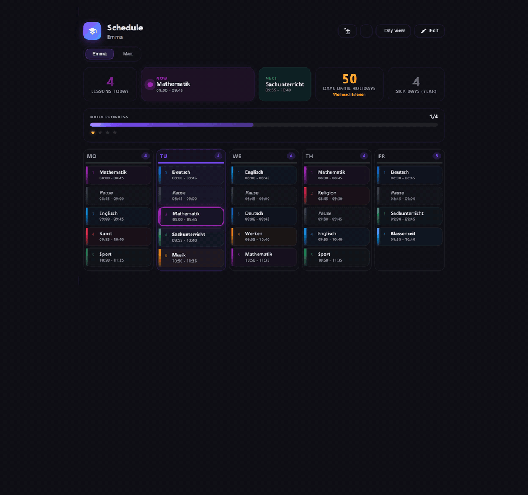
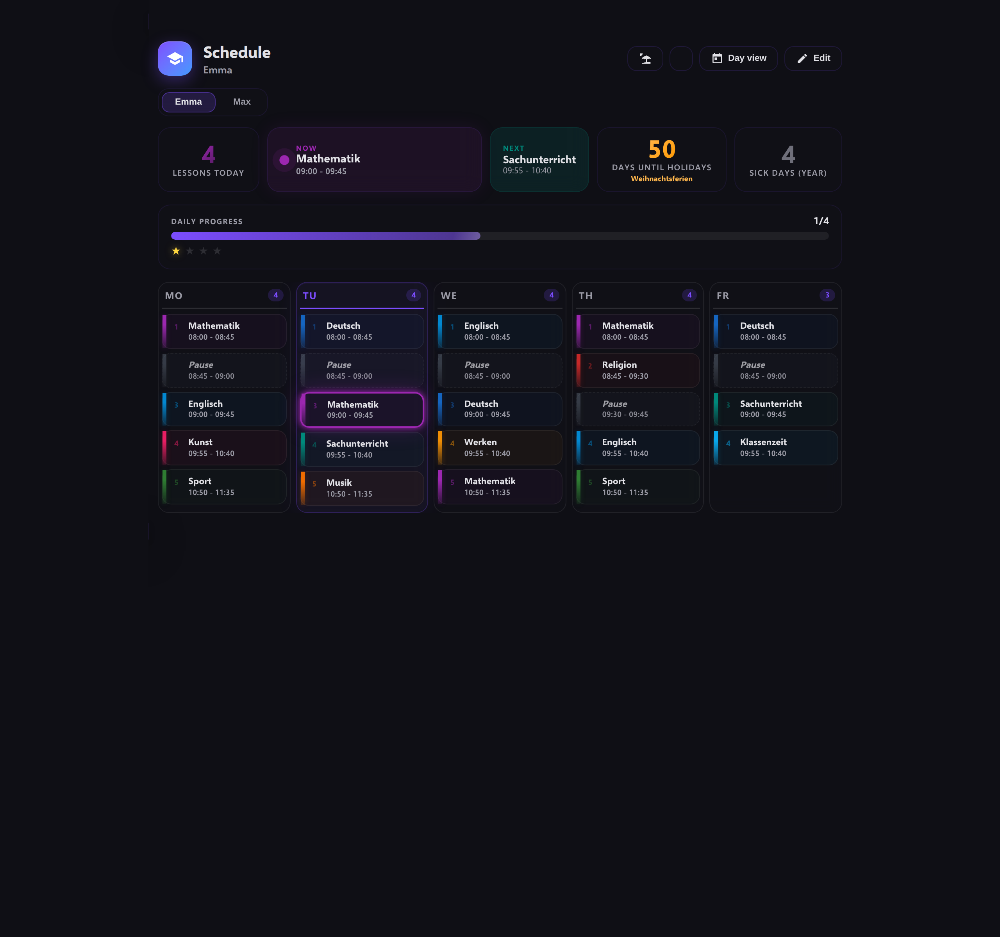
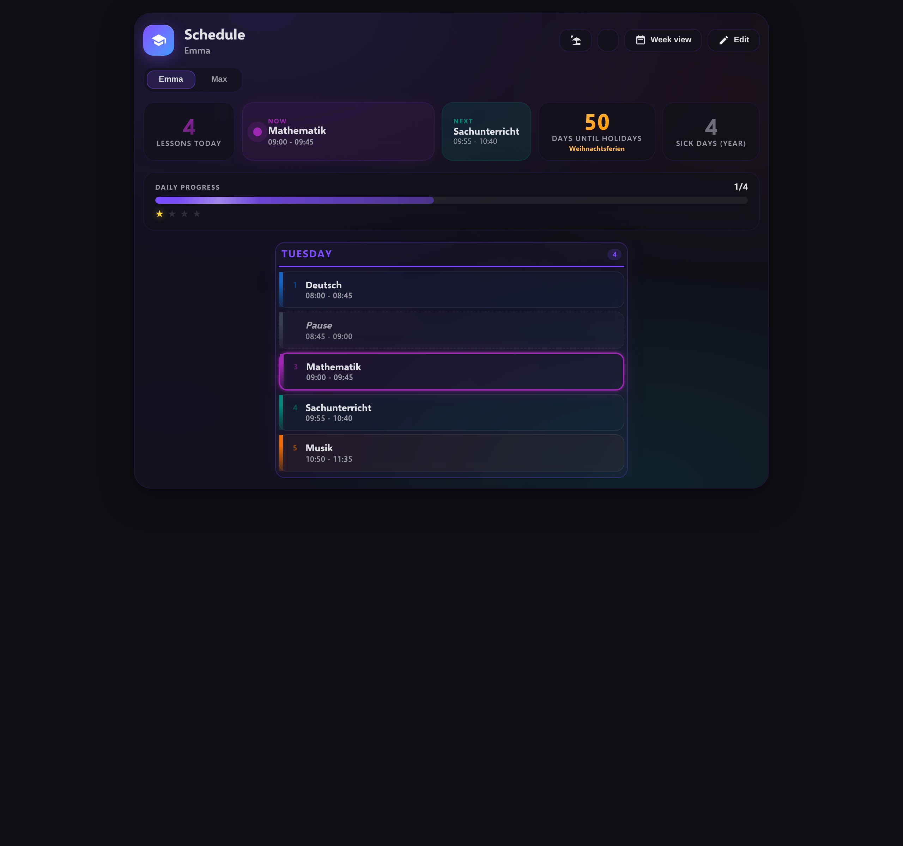
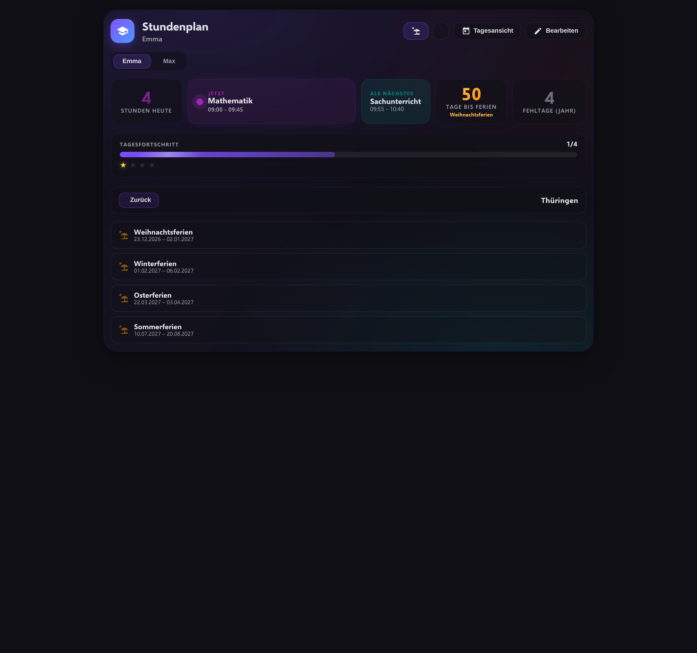
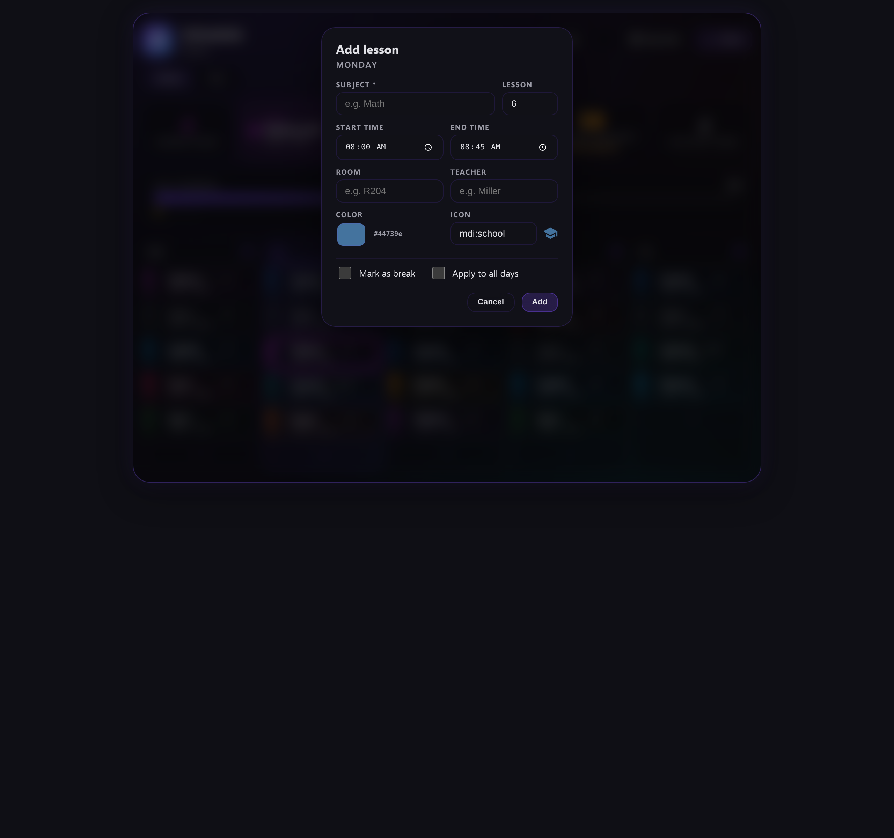
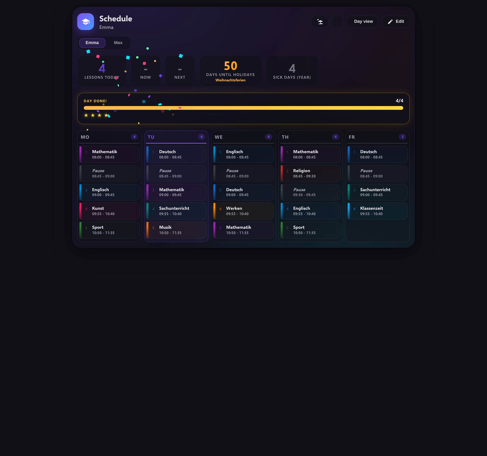
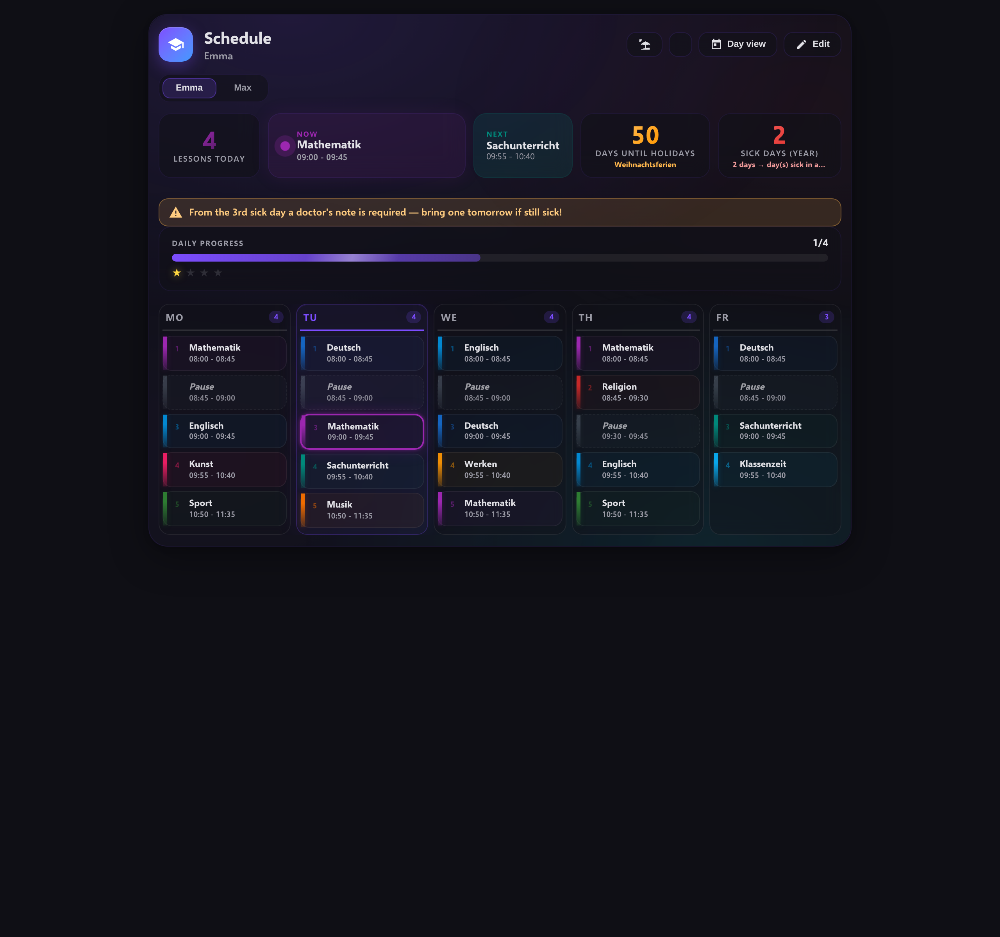
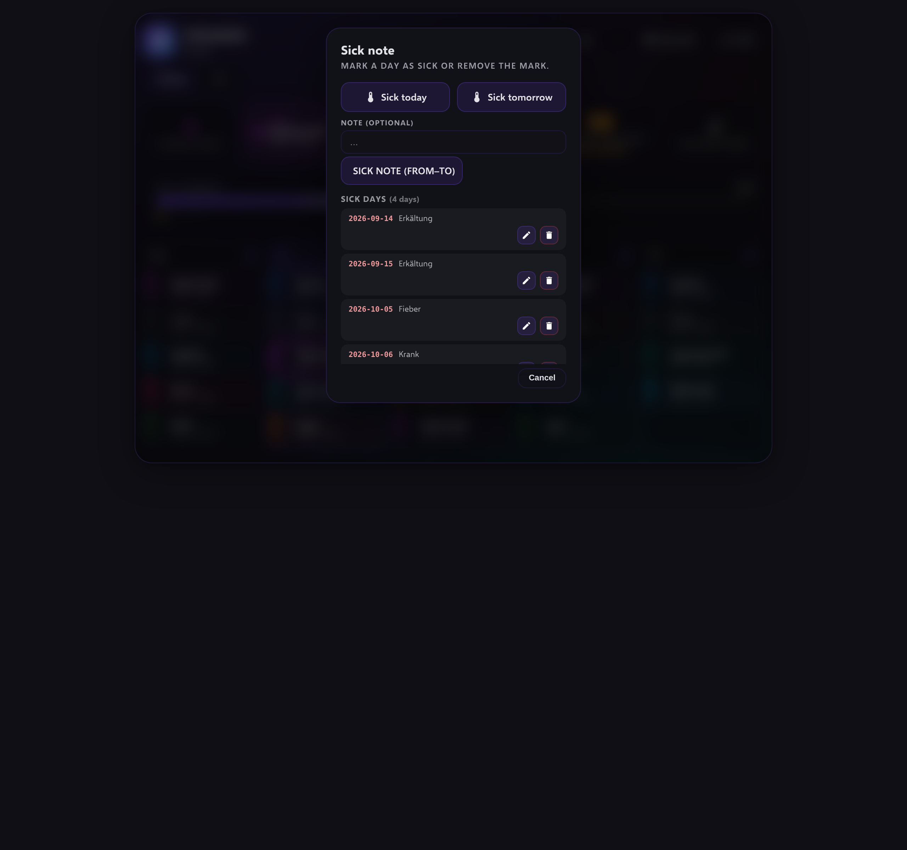
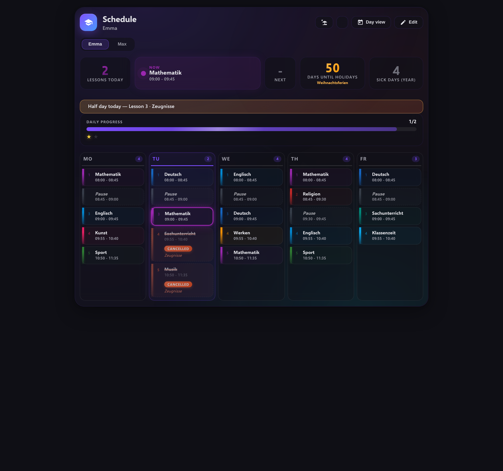
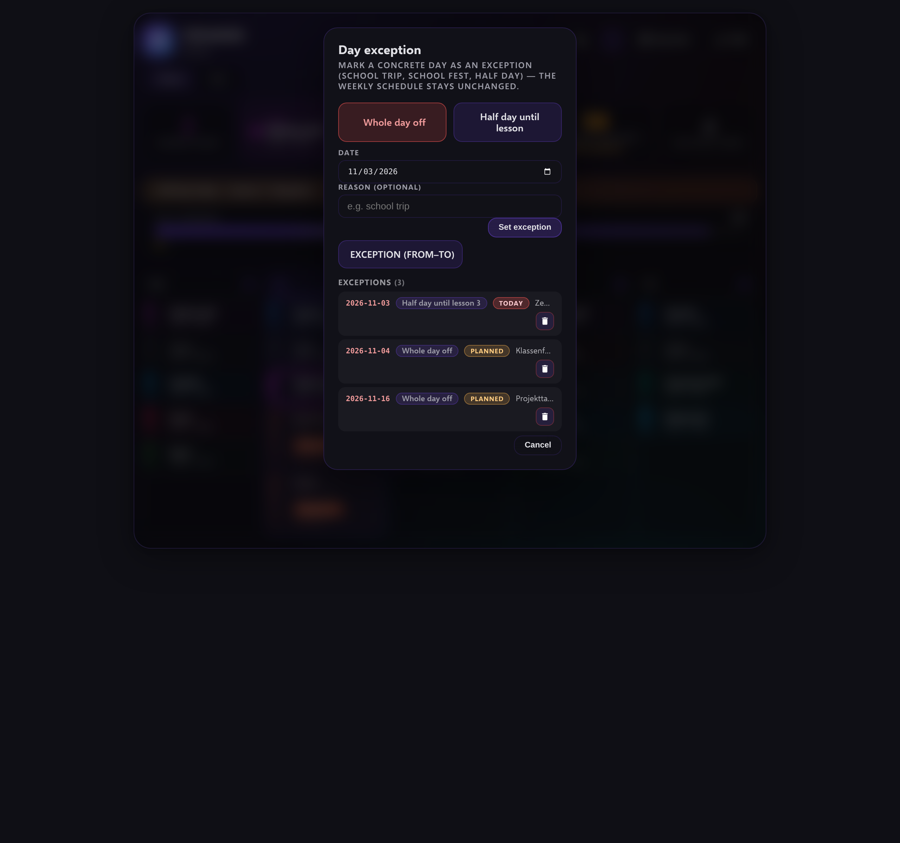

# School Schedule

[English](README.md) | **Deutsch**

Eine Custom-Integration für Home Assistant zur Verwaltung von Schulstundenplänen — mit einer Ultra-Premium-Lovelace-Card.


## Screenshots

**Ultra-Premium-Card — Wochenansicht, Tagesansicht, Ferienkalender, Bearbeitungsmodus, Kinder-Umschalter:**



| Wochenansicht (EN) | Tagesansicht |
|---|---|
|  |  |

| Ferienkalender (DE) | Bearbeitungsmodus + Inline-Formular |
|---|---|
|  |  |

**Tagesfortschritt, Sterne-Gamification + Konfetti, Krankheitstage inkl. deutscher Attest-Regel, Einzelstunden-Ausfall und Datums-Ausnahmen:**

| DAY DONE — goldener Fortschritt, 4 Sterne + Konfetti (v2.5.6) | Attest-Warnbanner — Krankheits-Streak Tag 2 (v2.6.0) |
|---|---|
|  |  |

| Fehltage-Manager — heute/morgen markieren, bearbeiten, löschen (v2.6.0/v2.7.0) | Stunden-Ausfall — durchgestrichen, ENTFÄLLT-Badge, Halbtag-Banner (v2.7.2/v2.7.3) |
|---|---|
|  |  |

| Datums-Ausnahmen-Manager — ganzer Tag frei, Halbtag, Zeiträume (v2.7.3) | Kinder-Umschalter — Leerzustand für ein Kind ohne Stunden |
|---|---|
|  |  |

*Alle Screenshots zeigen anonymisierte Demo-Daten (generische Namen, Fächer und Zeiten). Die Card erkennt die Farben deines HA-Designs automatisch.*

## Funktionen

### Integration
- **Mehrere Kinder:** Jedes Kind bekommt einen eigenen Stundenplan mit 7 Sensoren (heute, morgen, Montag–Freitag)
- **Config Flow:** Einrichtung komplett über die Home-Assistant-Oberfläche — kein YAML nötig
- **Services:** `add_lesson`, `remove_lesson`, `update_lesson`, `get_schedule`, `set_federal_state`
- **Lokale Aktualisierung:** Sensoren aktualisieren sich in Echtzeit, sobald Stunden geändert werden
- **Pausen-Unterstützung:** Stunden lassen sich als Pause markieren — eigene Darstellung (kein Raum/Lehrer, gestrichelter Rahmen, Kaffee-Icon) mit Uhrzeit
- **Auf alle Tage anwenden:** Beim Hinzufügen einer Stunde oder Pause optional auf alle Wochentage (Mo–Fr) gleichzeitig anwenden
- **Ferienkalender:** Deutsche Schulferien (mehr-schulferien.de) je Bundesland mit Countdown — Strand-Button
- **Schulfrei-Binärsensor (v2.5.0):** `binary_sensor.stundenplan_<kind>_schulfrei` pro Kind — `on`, wenn heute kein Unterricht ist (Ferien, Feiertag oder Wochenende), mit Attributen für den Status heute/morgen, den Grund, den nächsten Schultag, die nächsten Ferien und den nächsten Feiertag
- **Ferien-Caching (v2.5.0):** Feriendaten werden pro Bundesland nur 1× pro 24 h abgerufen (von allen Kindern geteilt) und im Config-Eintrag zwischengespeichert — sie überstehen Neustarts und Netzausfälle
- **Bundesland-Service (v2.5.0):** `set_federal_state` wechselt das Bundesland, ohne die Integration neu zu laden
- **Kalender-Entität pro Kind (v2.5.4):** `calendar.stundenplan_<kind>_kalender` — jede Stunde wird zu einem echten Kalender-Termin an ihrem Wochentag (wöchentliche Wiederholung); schulfreie Tage werden automatisch übersprungen (Ferien, Feiertage, Wochenende). Native Kalender-Karten, Automatisierungen („Stunde beginnt in X Min.") und kalenderbasierte Trigger funktionieren sofort. Read-only: Stunden werden über Services/Card verwaltet
- **Ferien-Pause (v2.7.7):** Schulfreie Tage (Ferien, Feiertag, freie Datums-Ausnahme, Wochenende) pausieren den Tagesplan — die Tages-Sensoren melden 0 Stunden mit `status`- und `reason`-Attributen statt der Wochentags-Template-Stunden; vollständig konsistent mit dem Schulfrei-Sensor und dem Kalender
- **Fehltage-Tracking (v2.6.0):** `sensor.stundenplan_<kind>_fehlzeiten` pro Kind — Zustand = Krankheitstage im laufenden Schuljahr (Aug–Jul), Attribute für krank heute/morgen, den aktuellen Streak, die Attest-Schwellen, den letzten Kranktag und den kürzlichen Verlauf
- **Fehltage-Services (v2.6.0):** `mark_sick_day` / `unmark_sick_day` — heute markieren (Standard) oder jedes beliebige Datum: Nachträgliches Eintragen (gestern) und Vormerken (morgen) funktionieren beide, mit optionaler Notiz („Fieber", „Erkältung")
- **Fehltage-Manager (v2.7.0):** Vollständig editierbare Fehltage-Liste im Modal — Notizen direkt bearbeiten, Einträge löschen (2-Klick-Bestätigung), Heute/Geplant-Badges, plus die Services `mark_sick_range` (Von–Bis) und `update_sick_day`
- **Einzelstunden-Ausfall (v2.7.2):** `mark_lesson_cancelled` / `unmark_lesson_cancelled` — eine einzelne Stunde für ein konkretes Datum absagen (Lehrer krank, Ausflug, Vertretungsplan), ohne den Wochenplan anzufassen. Ausgefallene Stunden erscheinen durchgestrichen in Warnrot mit ENTFÄLLT-Badge und Grundangabe; Zähler, JETZT/ALS NÄCHSTES, der Tagesfortschritt und die Kalender-Entität überspringen sie automatisch. Validierung: Wochenend-Daten und unbekannte Stunden-Slots werden abgelehnt
- **Datums-Ausnahmen (v2.7.3):** `mark_date_exception` / `mark_date_exception_range` / `unmark_date_exception` — kind-spezifische Tages-Ausnahmen, ohne den Wochenplan anzufassen: `free` (ganzer Tag ohne Unterricht — Klassenfahrt, Schulfest, Ausflug) oder `partial` (Halbtag — die Stunden 1 bis `until_lesson` finden statt, alles danach entfällt an diesem Datum). Eine freie Ausnahme übersteuert den landesweiten Tages-Status (freie Ausnahme > Ferien > Feiertag > Wochenende) und ist KEIN Kranktag — Fehltage-Zähler und Attest-Streak bleiben unberührt. Mehr-Tage-Zeiträume für Klassenfahrten; Wochenend-Validierung bei Einzeltagen
- **Attest-Regel (v2.6.0):** Deutsche Schulregel — ab dem 3. Krankheitstag in Folge wird ein ärztliches Attest benötigt. `attest_warning` feuert an Tag 2 („morgen ein Attest mitbringen, falls weiter krank"), `attest_required` ab Tag 3. Schulfreie Tage innerhalb eines Streaks (Wochenende, Feiertag) brechen ihn nicht; Ferien schon
- **Visueller Card-Editor:** Höhe/Breite über den Dashboard-Editor konfigurierbar (kein YAML)
- **Automatische Card-Einrichtung:** Die Integration registriert die Lovelace-Card-Ressource automatisch (browser_mod-Stil) — kein manuelles `www/`-Kopieren, keine manuelle Ressourcen-Registrierung, automatisches Cache-Busting bei Updates

### Lovelace Card (Ultra Premium)
- **3D-Glassmorphism-Design** mit animiertem Aurora-Hintergrund
- **Hero-Bereich:** Zeigt die aktuell laufende Stunde (JETZT) und die nächste Stunde (ALS NÄCHSTES) mit pulsierendem Indikator
- **Tagesfortschrittsbalken (v2.5.6):** „TAGESFORTSCHRITT"-Bereich unter den Hero-Pills — zählt beendete Stunden plus den anteiligen Anteil der laufenden Stunde (Pausen ausgenommen), Gradient-Balken mit animiertem Schimmer; wechselt in den goldenen „TAG GESCHAFFT!"-Zustand mit Leuchten, sobald die letzte Stunde endet
- **Sterne-Gamification + Konfetti (v2.5.6):** Ein Stern pro echter Stunde — grau, solange ausstehend, golden mit Leuchten, wenn verdient (Pop-Animation bei neuen Sternen); ein farbiger Konfetti-Ausbruch feuert genau einmal, wenn Schulschluss ist
- **Kinder-Umschalter:** Zwischen allen eingerichteten Kindern direkt in der Card wechseln (segmentierte Auswahl) — eine Card statt einer pro Kind
- **Ferien-Countdown:** Hero-Pill zeigt „Tage bis zu den Ferien" (oder die verbleibenden Ferientage) — Daten von mehr-schulferien.de, Klick öffnet den Ferienkalender
- **Fehltage-Pill + Modal (v2.6.0):** Hero-Pill zeigt die Fehltage des Jahres (oder den laufenden Streak, wenn heute krank) — Klick öffnet das Fehltage-Modal: Buttons „Heute krank" / „Morgen krank" (Umschalter, mit optionaler Notiz), Attest-Status und die letzten 5 Krankentage
- **Attest-Banner (v2.6.0):** Warnbanner unter dem Hero an Streak-Tag 2 („morgen ein Attest mitbringen, falls weiter krank") und pulsierendes Pflicht-Banner ab Tag 3 — Klick öffnet das Fehltage-Modal
- **Stunden-Ausfall (v2.7.2):** Der Bearbeitungsmodus ergänzt einen Kalender-Entfernen-Button pro Stunde — jede Stunde für ihr konkretes Datum mit optionalem Grund absagen („Lehrer krank"). Ausgefallene Stunden erscheinen durchgestrichen in Warnrot mit ENTFÄLLT-Badge; der Dialog bietet eine Ein-Klick-Wiederherstellung. Das Fehltage-Modal listet anstehende Ausfälle mit je einem Wiederherstellen-Button
- **Datums-Ausnahmen-Manager (v2.7.3):** Ein neuer Kalender-Entfernen-Button in der Kopfzeile öffnet das Ausnahmen-Modal — jeden Tag als „ganzer Tag frei" (Klassenfahrt) oder „Halbtag bis Stunde N" (Zeugnisse) markieren, Einzeltage oder Von–Bis-Zeiträume, mit editierbarer Liste (2-Klick-Löschen, Heute/Geplant-Badges). Ausnahme-Banner unter dem Hero zeigen die Ausnahme heute/morgen mit Begründung; abgesagte Stunden eines Halbtags erscheinen im etablierten durchgestrichenen Warn-Design
- **Tagesansichts-Umschalter:** Zwischen Wochenansicht (5-Spalten-Raster) und Tagesansicht (eine Spalte, größere Karten) per Button wechseln
- **Inline-Verwaltung:** Stunden direkt in der Card hinzufügen, bearbeiten und löschen — der Config Flow muss dafür nicht geöffnet werden
  - **Hinzufügen:** „+"-Button pro Tag öffnet das Inline-Formular
  - **Bearbeiten:** Stift-Icon an jeder Stunde
  - **Löschen:** Papierkorb-Icon mit Bestätigungsdialog
- **Farbkodierte Stunden:** Jede Stunde hat eine eigene Farbe und ein eigenes Icon
- **Pausen-Darstellung:** Pausen mit gestricheltem Rahmen, kursivem Fach, Kaffee-Icon — ohne Raum/Lehrer-Anzeige
- **Pausen-Formular:** Checkbox „Als Pause markieren" + „Auf alle Tage anwenden" im Inline-Formular. Raum/Lehrer werden bei Pausen automatisch deaktiviert
- **Ferienkalender:** Deutsche Schulferien von mehr-schulferien.de — Bundesland wählen, aktuelle und kommende Ferien mit Countdown sehen. Bundesland und Daten liegen **in der Integration (pro Kind)**, nicht im Browser — sie überstehen HA-/HACS-Updates, geleerte Browser-Caches, App-Neuinstallationen und Gerätewechsel (v2.7.1)
- **Responsive Auto-Fill-Spalten:** Tage rutschen bei schmalen Karten automatisch in die nächste Reihe — kein Scrollen nötig
- **Visueller Editor:** Höhe und Breite der Card über den visuellen Dashboard-Editor einstellen
- **Hero-Bereich:** Aktuell laufende Stunde (JETZT) und nächste Stunde (ALS NÄCHSTES)
- **Responsiv:** Passt sich Handy und Desktop an

## Installation

### Über HACS (empfohlen)

1. Öffne HACS in deiner Home-Assistant-Instanz
2. Gehe zu **Integrationen** → **+ Repositorys erkunden und herunterladen**
3. Suche nach „School Schedule" und klicke auf **Herunterladen**
4. Starte Home Assistant neu
5. Gehe zu **Einstellungen** → **Geräte & Dienste** → **Integration hinzufügen**
6. Suche nach „School Schedule" und gib den Namen des Kindes ein

Das ist alles — die Lovelace-Card wird automatisch eingerichtet:

- Die Integration liefert die mitgelieferte Card aus ihrem eigenen Verzeichnis aus und registriert die Dashboard-Ressource für dich (URL: `/school_schedule.js?v=<version>`)
- Kein manuelles Kopieren nach `<config>/www/`, keine manuelle Ressourcen-Registrierung
- Hast du die Card früher manuell eingerichtet, wird die alte Ressource automatisch auf die neue URL migriert — nach dem Update einfach den Browser neu laden
- Bei jedem HACS-Update sprengt der Versionsparameter den Browser-Cache automatisch

### Manuell

1. Lade das neueste Release von der [Releases-Seite](https://github.com/svenachilles1/school-schedule/releases) herunter
2. Kopiere `custom_components/school_schedule/` nach `<config>/custom_components/school_schedule/`
3. Starte Home Assistant neu
4. Füge die Integration hinzu: **Einstellungen** → **Geräte & Dienste** → **Integration hinzufügen** → „School Schedule"

Die Lovelace-Card-Ressource wird automatisch registriert — kein Kopieren nach `www/`, keine Ressourcen-Registrierung nötig.

## Konfiguration

### Kind einrichten

1. Gehe zu **Einstellungen** → **Geräte & Dienste** → **Integration hinzufügen**
2. Suche nach „School Schedule"
3. Gib den Namen des Kindes ein (z. B. „Tom")
4. Die Integration erstellt automatisch 7 Sensoren

### Stunden hinzufügen

**Über die Card (empfohlen):**
1. Füge die School-Schedule-Card deinem Dashboard hinzu
2. Konfiguriere die Card mit dem Parameter `child_name`
3. Klicke auf „Bearbeiten", um in den Bearbeitungsmodus zu wechseln
4. Klicke auf den „+"-Button eines Tages, um eine Stunde hinzuzufügen
5. Fülle das Formular aus (Fach, Uhrzeit, Raum, Lehrer, Farbe, Icon)
6. Klicke auf „Hinzufügen"

**Über Services:**
```yaml
service: school_schedule.add_lesson
data:
  child_name: dein_kind
  weekday: monday
  lesson_number: 1
  subject: Mathematik
  room: R204
  teacher: Herr Müller
  start_time: "08:00"
  end_time: "08:45"
  color: "#44739e"
  icon: mdi:school
  is_break: false
  apply_to_all_days: false
```

**Pause auf alle Tage gleichzeitig hinzufügen:**
```yaml
service: school_schedule.add_lesson
data:
  child_name: dein_kind
  weekday: monday
  lesson_number: 3
  start_time: "10:00"
  end_time: "10:15"
  is_break: true
  apply_to_all_days: true
```

### Card-Konfiguration

```yaml
type: custom:school-schedule-card
child_name: Tom
```

| Option | Typ | Pflicht | Beschreibung |
|--------|------|----------|-------------|
| `child_name` | string | ja | Name des Kindes (muss zur Integrations-Konfiguration passen) |

## Services

| Service | Beschreibung |
|---------|-------------|
| `school_schedule.add_lesson` | Fügt eine Stunde zum Stundenplan eines Kindes hinzu |
| `school_schedule.remove_lesson` | Entfernt eine Stunde per Wochentag und Stundennummer |
| `school_schedule.update_lesson` | Aktualisiert eine bestehende Stunde (optionales `lesson_uid` zur eindeutigen Adressierung) |
| `school_schedule.get_schedule` | Holt den Stundenplan für einen bestimmten Tag oder alle Tage — **liefert den Plan als Service-Antwort zurück** (`supports_response=ONLY`) |

## Sensoren

Jedes Kind bekommt 7 Sensoren:

| Sensor | Beschreibung |
|--------|-------------|
| `sensor.stundenplan_<kind>_heute` | Stunden heute |
| `sensor.stundenplan_<kind>_morgen` | Stunden morgen |
| `sensor.stundenplan_<kind>_montag` | Stunden am Montag |
| `sensor.stundenplan_<kind>_dienstag` | Stunden am Dienstag |
| `sensor.stundenplan_<kind>_mittwoch` | Stunden am Mittwoch |
| `sensor.stundenplan_<kind>_donnerstag` | Stunden am Donnerstag |
| `sensor.stundenplan_<kind>_freitag` | Stunden am Freitag |

Der `heute`-Sensor liefert zusätzlich die Attribute `current_lesson` und `next_lesson`. Beide enthalten ein `is_break`-Flag für Pausen.

**Ferien-Pause (v2.7.7):** Schulfreie Tage (Ferien, Feiertag, freie Datums-Ausnahme oder Wochenende) pausieren den Tagesplan: Jeder Tages-Sensor meldet `0` Stunden für sein konkretes Datum (heute/morgen: genau dieses Datum; Wochentag-Sensoren: das nächste Vorkommen ihres Wochentags) und stellt die Attribute `status` (`school_day`, `vacation`, `public_holiday`, `date_exception`, `weekend`) und `reason` bereit. Eine `partial`-Datums-Ausnahme (Halbtag) pausiert den Tag NICHT — sie erzeugt nur Stunden-Ausfälle.

### Pausen

Stunden lassen sich als Pause markieren (`is_break: true`). Pausen werden in der Card anders dargestellt:
- Gestrichelter Rahmen statt durchgezogen
- Kursiver Fachtext (Standard „Pause")
- Kaffee-Icon statt Stundennummer
- Kein Raum oder Lehrer sichtbar
- Uhrzeit wird weiterhin angezeigt

Beim Hinzufügen einer Pause ist `subject` optional (Standard „Pause"); `room`/`teacher` werden automatisch geleert. Mit `apply_to_all_days: true` wird dieselbe Pause auf alle Wochentage gleichzeitig angewendet.

## Lizenz

MIT-Lizenz — siehe [LICENSE](https://github.com/svenachilles1/school-schedule/blob/main/LICENSE)
